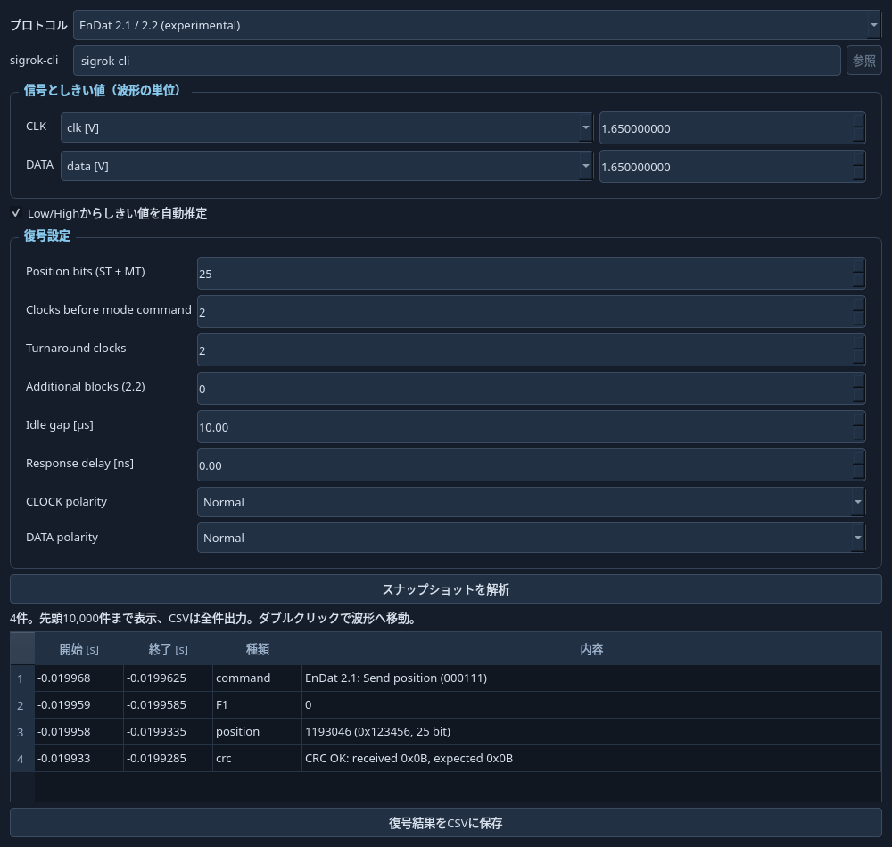

# EnDat 2.1 / 2.2解析（実験的）

[プロトコル解析](protocols.md) / [ドキュメント一覧](README.md)

取得済みのCLOCKと双方向DATAから、PC側で受動的に復号します。エンコーダーへの送信・パラメーター書込は行いません。sigrok-cliは不要です。DL1640のファーム更新も不要で、元サンプルを読み込めればファイルからも解析できます。

## 公開資料と採用した仕様

- [HEIDENHAIN EnDat 2](https://endat.heidenhain.com/endat2)：2.1/2.2の互換性と公開資料への入口。
- [HEIDENHAIN Technical Information](https://endat.heidenhain.com/fileadmin/pdf/en/01_Products/Technische_Dokumentation/TI_EnDat_2-2_ID383942_en.pdf)：CLOCK/DATAの差動・双方向構成、位置・追加情報の概要。
- [TI TIDUAL5、6章](https://www.ti.com/lit/ug/tidual5/tidual5.pdf)：モードコマンド、位置値LSB先頭、タイミング図と追加情報。
- [TI公式のドライバー](https://github.com/TexasInstruments/motor-control-sdk/blob/main/source/position_sense/endat/driver/endat_drv.c) と [コマンド定義](https://github.com/TexasInstruments/motor-control-sdk/blob/main/source/position_sense/endat/firmware/endat_params.h)：6ビットのコマンド値、受信フィールドの長さ・順序、CRCの独立照合。
- [Analog Devices AN-2634](https://www.analog.com/en/resources/app-notes/an-2634.html)：2.1位置読み出し、アイドル状態、STARTへの同期。

資料にCRCを6ビットとする記載もありますが、TIの実装では5ビットです。本実装は同実装の `endat_make_crc_pos` / `endat_make_crc_norm` と照合して、生成多項式 `x^5+x^3+x+1`、初期値 `0x1f`、結果反転、CRC送信はMSB先頭を採用しています。位置値のLSB先頭と、CRCのビット順は別です。

## 使い方

1. CLOCK/DATAを同時刻・等間隔で取得してSTOPするか、対応するファイルを開きます。
2. 左パネルの「プロトコル解析」を開き、`EnDat 2.1 / 2.2 (experimental)` を選びます。
3. CLKとDATAのCH、しきい値、極性を選びます。差動信号の場合は差動プローブや、適切に得られた差動波形を使用してください。負側だけを記録した場合などは極性を反転します。
4. `Position bits (ST + MT)` を実際のエンコーダーの総位置ビット長に設定します。既定25は入力の初期値であり、自動判定ではありません。角度・距離の単位への変換は行わず、整数値を表示します。
5. 2.2の追加情報を取得している場合は `Additional blocks` を0〜2で指定します。MRSを追跡した自動設定ではないため、途中で構成が変わる記録は区間ごとに分けてください。
6. 必要ならフレーム境界・遅延を調整して解析します。結果表のダブルクリックで波形へ移動し、CSVへ出力できます。

| 設定 | 内容 |
|---|---|
| Clocks before mode command | モード6ビットの前のクロック数。初期値2 |
| Turnaround clocks | コントローラー送信後、STARTを探し始めるまでのクロック数。初期値2 |
| Idle gap [µs] | フレームを区切るCLOCK High期間。初期値10µs。通常のHigh半周期より長く、実際のアイドル期間以下に設定 |
| Response delay [ns] | CLOCKに対する応答DATAのサンプル位置補正。正値は遅いDATAに合わせる。サンプル刻みへ丸める |

クロックのHigh/Low半周期の中央で判定します。コマンドと応答ではDATAの更新エッジが異なるため、それぞれHigh側・Low側を使います。少なくとも1周期4サンプルが必要で、ノイズや遅延のある実信号ではさらに余裕を持たせてください。

## 対応範囲と制約

- 14種類のモードコマンドを識別し、2.1/2.2をコマンドから判定します。不正・未知のコマンド、START不足、途中で切れた応答、CRC不一致は警告として表示します。
- 位置応答：1〜64ビットの位置値、F1、2.2のF2、5ビットCRC。フラグは線上の0/1を表示します。
- パラメーター応答：8ビットのアドレス、16ビット値、CRC。メモリー内容の意味の解釈や書込操作は行いません。
- テスト応答：40ビット値とF1、CRC。
- 2.2追加情報：各24ビットの生の値とCRC（ブロック間の区切り1クロック）。温度などの意味・単位への変換、MRS履歴による分類は未実装です。
- 2.2の複合コマンドは位置応答部分を復号します。後続の補助コマンドペイロードの解釈は未対応と明示します。
- CLOCK Highのアイドル区間を含む、コマンド付きのトランザクションが対象です。先頭が途中から始まるフレームは推測しません。連続クロックで境界のない転送、コマンド省略の連続モード、自動ケーブル遅延推定、安全機能の検証は未対応です。フレーム内でCLOCK Highを長く停止させる記録は、Idle gapの調整でも区別できない場合があります。
- 補間・間引き後の描画配列は使用しません。元サンプルをしきい値化し、元波形と測定条件は変更しません。

## 検証

`tests/test_endat.py` で、2.1位置、2.2の35ビット位置とF1/F2・追加情報、パラメーター、CRC異常、欠けた応答、不正コマンド、複数フレーム、極性反転、遅延補正を合成波形で検証しています。CRCの固定値5件は、TI公開Cソースの関数を別途コンパイルした結果と一致します（25/35/64ビット位置、24ビット追加情報・パラメーター）。

解析は30秒・注釈100,000件を上限とし、超えた場合は短い記録での再試行を案内します。

実際のEnDatエンコーダーのキャプチャとの照合は未実施です。合成波形の成功は、機種固有条件や全モードの実機互換性の保証ではありません。検証できた範囲と、未対応の高度な機能を分けて保持しています。
