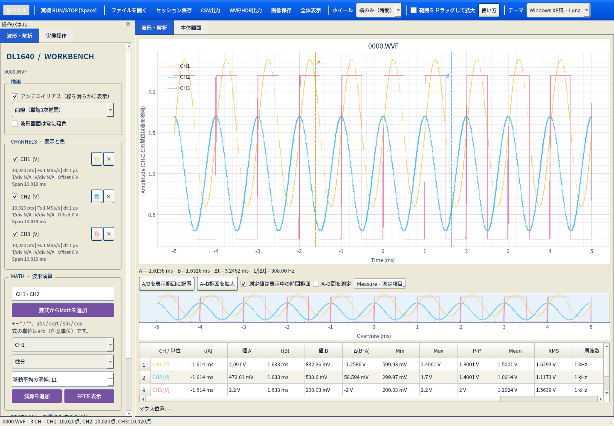
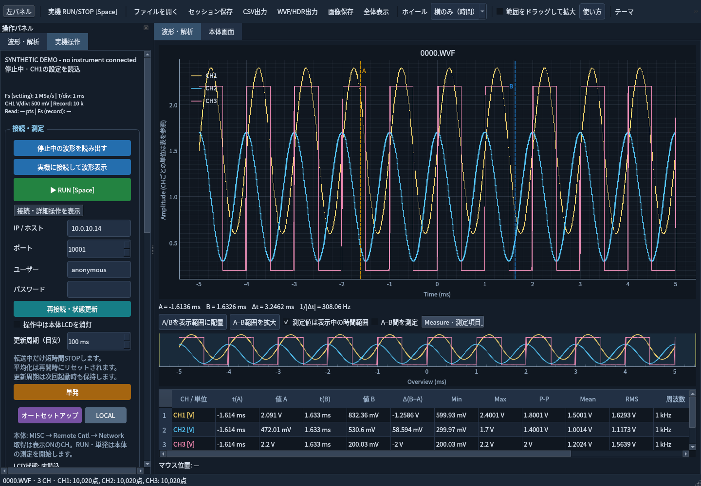
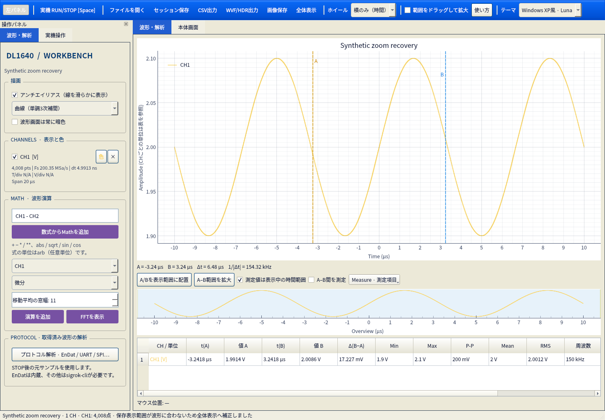

# 使い方

[ドキュメント一覧](README.md) / [内部処理](implementation.md) / [開発・スクリプト](development.md)

WVF/HDRを開いて解析する場合、実機への接続は不要です。

## 起動

Linux展開実行版を使う場合は、展開先で `./run.sh` を実行してください。Pythonやuvの事前導入は不要です。[配布物の使い方・ビルド手順](packaging-linux.md)に対応環境と検証方法をまとめています。以下はソースから起動する手順です。

[uv](https://docs.astral.sh/uv/getting-started/installation/) をインストール後、プロジェクト直下（`pyproject.toml` があるフォルダ）で実行してください。初回はPython 3.12と依存パッケージを取得するためインターネット接続が必要です。

```bash
uv sync --locked --python 3.12
uv run --locked yokogawa-tool
```

サンプルを直接開く場合:

```bash
uv run --locked yokogawa-tool demo/0000.WVF
```

Linuxでは `bash run.sh demo/0000.WVF`、Windowsでは `run.cmd` でも起動できます。既に構築済みのこの作業環境では `.venv/bin/yokogawa-tool demo/0000.WVF` で起動できます。

Linuxのデスクトップ環境（WaylandまたはX11）が必要です。Qtのxcbプラグインが不足ライブラリのエラーを出す場合は、[QtのLinux必要ライブラリ](https://doc.qt.io/qt-6/linux-requirements.html) を確認してください。

## 表示モード

画面中央上部で **「波形・解析」／「本体画面」** を切り替えます。

| モード | 扱うデータ | 使える機能 |
|---|---|---|
| 波形・解析 | 時刻と各CHの数値配列 | ファイル読込、CH色、カーソル、統計、Math、セッション・CSV、数値波形ライブ |
| 本体画面 | DL1640の画面画像 | 手動・自動画面取得、画像の拡大・移動、PNG保存 |

モード切替では、読み込んだ波形、Math、色、ズーム、カーソル、未保存状態を保持します。画像を数値波形に変換したり、画像にMath・カーソル測定を適用したりはしません。本体画面モード中は数値波形の解析操作・セッション保存・CSV出力を無効にし、解析モードへ戻すと再び操作できます。画面画像はセッションに含めません。

### 本体画面の使い方

1. 左パネルの「実機操作」でIP・ユーザー名・パスワードを設定します。今回検証した本体のIPは `10.0.10.14` です。
2. 中央の「本体画面」タブを選択します。切替だけでは通信せず、数値波形のライブ更新を停止します。
3. 「本体画面を取得」で手動更新します。「本体画面の自動更新を開始」で繰り返し取得できます。HTTPポートの既定は **80** で、機器制御用の10001とは別です。
4. 自動更新の既定は10秒、指定範囲は1〜60秒です。取得時間を含む目標周期で、実際の画像取得が遅ければそれ以上の速さにはなりません。同時要求は出しません。
5. ホイールで画像を拡大縮小し、ドラッグで移動します。「ウィンドウに合わせる」と「原寸」で戻せます。これは画像の拡大で、数値データのズームではありません。
6. 「本体画面をPNG保存」または上部の「画像保存」で、取得した元のPNGを保存します。画面上の拡大率に関係なく元画像を保存します。

（実測したメーカー画面の画像はローカル保管とし、公開版には含めません。）

本体の `http://<IP>:<HTTPポート>/webmonimage.png` を直接取得します。ブラウザ・ActiveX・Wirepullerは使いません。画面取得はRUN/STOPコマンドを送らず、実機で取得後もRUNを維持することを確認しました。数値波形ライブと画面の自動更新は排他的で、モードを切り替えた場合は自動更新を終了します。接続先変更・取得エラーでも自動更新を終了します。

F1.08の個体では、STOP中の取得が約3.61秒、RUN中は約7.34秒でした。1秒周期を選んでも1fpsにはなりません。応答待ちは最大20秒（ソケットの接続・読み出し待ち）に設定しています。取得中は機器制御を同時に実行せず、操作を直列に処理するため、設定反映が画像取得の終了まで待たされることがあります。

## 波形の読み込みと表示

テーマはツールバーから **Dark / Light / Windows XP風Luna** を選択できます。次回起動時にも保持します。XP風はアプリ内部の配色とボタンのスタイルに適用され、タイトルバーはOSの表示を使います。



- 「ファイルを開く」またはファイルをドラッグ＆ドロップ。WVFと同名のHDRを同じフォルダに置き、どちらかを選択します。
- CSVは先頭列が時刻 **秒**、2列目以降が各CHの値です。UTF-8、カンマ区切りに対応します。
- メイン波形のホイールは、ツールバーの「ホイール」で **横のみ（時間）／縦のみ（振幅）** を選択できます。既定は横のみで、選択は次回起動時も保持します。ドラッグで移動、「範囲をドラッグして拡大」で矩形拡大。`Home` / 「全体表示」で元に戻ります。
- 下段Overviewでは、ホイールで常にメイン波形の時間軸のみを拡大縮小します。Overview自身は全体表示を保ち、選択範囲が追従します。範囲のドラッグでも表示時間を変えられます。
- 左の操作パネルはツールバーの「左パネル」または `Ctrl+B` で折り畳み・再表示できます。パネル右上の「×」でも閉じられます。
- 左パネルは「波形・解析」「実機操作」の2タブです。ファイル解析中は実機操作を隠して、CH・Mathの操作に使えます。
- 「波形・解析」タブの**アンチエイリアス**は既定ONで、斜線の階段状のギザギザを軽減します。メイン波形・Overview・FFTに反映し、設定は次回起動時も保持します。重い場合はOFFにできます。処理は描画だけに適用し、生データ・測定値・Mathは変更しません。データ自体の段差やノイズを減らす場合は、Mathの移動平均を別波形として追加してください。
- 通常はアンチエイリアス付きで線分をまとめて描き、Overviewをキャッシュします。方形波の長い縦線などで描画負荷が高いときは、メイン波形・Overviewを1pxの線とアンチエイリアスなしで高速描画します。中間倍率でも対象になり、十分拡大して負荷が下がると設定した滑らかな描画へ戻ります。切替境界での頻繁な往復も抑えます。ピークを保持する表示用の間引きは従来どおりで、元サンプル・測定値・Math・保存内容は変わりません。測定表の更新は約60ms間隔にまとめます。
- 各CHのチェックで表示切替、「色」で色変更、「×」で波形を削除します。
- 「描画」の補間は直線・階段・単調3次曲線から選択できます。曲線補間は拡大時の表示だけに適用し、元サンプル・Measure・Math・CSV/NPZ/WVF出力は変えません。欠損区間をつながず、密集したピーク表示には補間を追加しません。表示方式は次回起動時とセッションに保持します。
- CH欄は小さめの英語表記で、`pts`（点数）、`Fs`、`dt`、`T/div`、`V/div`（単位に応じてA/div等）、`Offset`、`Span`（最後と最初のサンプルの時間差）を表示します。div値が未記録なら `N/A`、非等間隔のCSVなどは `non-uniform` と表示します。T/div・V/div・Offsetは読み出し時に照会した本体設定で、STOP中に設定を変えた場合などは記録当時の条件と異なることがあります。値を推測して埋めません。
- 「波形画面は常に暗色」をONにすると、LightやXP風テーマでも波形・Overview・FFTの背景と軸は暗色になります。UIのテーマとは別に保持します。
- A/Bの縦線をドラッグすると、最寄りの実サンプルの時刻・値、電圧差、時間差、`1/|Δt|` を表示します。`1/|Δt|` はカーソル間隔の逆数で、信号周波数の自動推定ではありません。
- マウス位置でも最寄りサンプルの値を確認できます。データ範囲外は「—」表示です。
- 表の上の「Measure · 測定項目」で表示する項目を選べます。選択は次回起動時も保持します。「測定値は表示中の時間範囲」を外すと全体、「A–B間を測定」をONにするとカーソル間を集計します。元サンプルを使用し、表示用の間引き結果は使いません。
- 異なる単位も同じY軸に重ねます。各波形の単位はCH一覧と測定表を確認してください。

CSVの例:

```csv
time_s,CH1[V],CH2[V]
0.000000,1.20,0.10
0.000001,1.25,0.15
0.000002,1.10,0.20
```

時刻は昇順・重複なし、2サンプル以上が必要です。ヘッダなしの場合はCH1、CH2…、単位Vとして読み込みます。

## Math

- 数式: `CH1 - CH2`、`(CH1 + CH2) / 2`、`CH1 * CH2`、`abs(CH1)`、`sqrt(CH1)` など。
- 使用可能: 波形名、数値、`+ - * / **`、`abs / sqrt / sin / cos`。指数は−16〜16の定数です。Pythonコードは実行しません。
- 複数波形の演算にはサンプル数と時刻が一致する必要があります。暗黙の補間はしません。
- 数式の結果は単位を自動推定せず `arb` と表示します。ゼロ除算や定義域外は欠損として表示します。
- CH選択後に微分、台形積分（先頭点を0とする）、移動平均（窓幅指定、端点は端の値で補う）を追加できます。
- FFTは別ウィンドウ。波形全体にHann窓を適用し、窓のコヒーレントゲインを補正した片側ピーク振幅スペクトルを表示します。DCは除去しません。
- FFT / 微分 / 積分 / 移動平均は等間隔サンプリングが必要です。FFTは欠損値を含む波形では実行しません。
- Mathは追加した時点の計算結果を保存します。元波形を削除しても結果は残ります。

## Measure（自動測定）

Measureは次の21項目に対応します。

| 種類 | 項目 |
|---|---|
| 振幅・統計 | Min、Max、P-P、Mean、RMS、標準偏差、AC RMS、中央値、Low、High、振幅 High−Low |
| タイミング | 周波数、周期、正／負デューティ比、正／負パルス幅、立上り10–90%、立下り90–10% |
| エッジ | 立上り回数、立下り回数 |

統計値は欠損を除外します。Low/Highは対象範囲の2つのレベルを自動推定し、その間の10/50/90%を使ってタイミングを計算します。50%交差時刻はサンプル間を線形補間し、10/90%まで到達した遷移だけを確定します。周期・パルス幅・立上り／立下り・デューティ比は有効な測定値の中央値です。周波数は周期の逆数です。欠損をまたいで周期やパルス幅を計算せず、周期が足りない、DC、振幅が小さすぎる場合などは「—」になります。

このMeasureはPC側の計算です。本体のMEASURE値と同一のアルゴリズムではありません。自動レベルはノイズ・歪み・測定範囲に影響されるため、特に不規則な信号では波形と合わせて確認してください。Measureの手動レベル指定は未対応です。プロトコル復号は[別の解析画面](protocols.md)を使用します。

## 保存と別PCでの利用

「セッション保存」（`Ctrl+S`）で `.scope.npz` を保存します。ファイルには**全波形の実データ、CH名・単位・色・表示状態、拡大範囲、A/B位置**を含みます。元のWVF/HDRへのアクセスは不要です。

保存された表示範囲が波形の時間範囲から外れている、または極端に広い場合は、読み込み時に元データの範囲を使って表示を補正します。補正した場合は画面下部に表示します。通常のズームは維持し、元ファイルは変更しません。これにより、短い波形が極端なズームアウトで描画されなくなっていたセッションも開けます。「全体表示」も描画用の間引き結果ではなく元サンプルから範囲を求めます。

保存ダイアログでは `.scope.json` も選べます。こちらも全波形と表示設定を含むため、以前保存したJSONセッションをそのまま開けます。通常はサイズの小さい `.scope.npz` を使用してください。

NPZは[NumPyの公開された配列保存形式](https://numpy.org/doc/stable/reference/generated/numpy.savez_compressed.html)で、ZIP内にNPY配列を格納します。ただし、このソフトの `.scope.npz` の項目名・表示設定の構成は独自です。Python/NumPyから読めますが、他の波形解析ソフトで直接開けるとは限りません。

| 用途 | 保存形式・操作 |
|---|---|
| このソフトで解析状態ごと再開する | セッション保存：NPZ / JSON |
| 表計算や他の解析環境へ数値を渡す | CSV出力：`Ctrl+E` |
| Yokogawa形式を扱うPCソフトへ渡す | WVF/HDR出力：`Ctrl+Shift+E` |

「WVF/HDR出力」は、同名の `.WVF`（波形）と `.HDR`（換算・時間軸情報）を作成します。両方を一緒に持ち運んでください。非表示CH・Mathを含む全波形の全サンプルを、64ビット浮動小数点（FS8）で保存し、振幅を整数に丸め直しません。時間軸は開始時刻と刻み幅で表すため、浮動小数点の丸め誤差が生じることがあります。不等間隔の時間軸は補間せずエラーにし、CSV/NPZでの保存を案内します。CH名と単位には空白のないASCII文字が必要です。

このWVF/HDRはPC解析用の出力です。生のADC整数、本体固有の設定領域、取得していない履歴、色・ズーム・カーソル位置は含みません。DL1640本体への再読込や他社・メーカー製ソフトでの受入れは未検証です。FS8に対応しないソフトにはCSVを使用してください。出力してもセッションの未保存表示は解除しません。

別PCへはこのプロジェクト（`src`、`pyproject.toml`、`uv.lock`、`readme.md`、`docs`、起動スクリプト）をコピーし、上記の `uv sync --locked --python 3.12` を実行してください。`.venv` はPC間でコピーせず、それぞれのPCで作成します。`uv.lock` により同じOS・Python条件で依存パッケージの版を揃えます。

「CSV出力」（`Ctrl+E`）は非表示CH・Mathを含む全波形を出力します。異なる時間軸がある場合は時刻の和集合を使い、その時刻にサンプルがないCHは `nan` にします。補間しません。「画像保存」は現在の波形表示をPNGで出力します。

## DL1640へのEthernet接続

通常のRUN、波形接続表示、停止波形の読込以外は「接続・詳細操作を表示」に折り畳んでいます。IP・認証・状態更新・LCD手動操作・更新周期・単発・LOCALなどはここを展開してください。

実機タブの上部には、`Fs (setting)` / `T/div` / 選択CHの `V/div`、`Record`（設定した記録長）、`Read`（最後に取得した実点数）、`Fs (record)`を表示します。本体設定のレートは `:TIMEBASE:SRATE?`、取得波形のレートは `:WAVEFORM:SRATE?` を使用します。設定変更や履歴レコードの違いによって一致しない場合があるため、両者を分けています。CH選択・設定読込・波形取得に合わせて更新し、接続先を変更すると古い値を消します。

### 取得点数は何で決まるか

このソフトは `DLENGTH AUTO` を使用し、最新レコード0の `WAVEFORM:LENGTH?` が返す全点を読みます。画面幅や曲線補間の設定で取得点数を減らすことはありません。描画用の間引きは転送後に行います。

本体の設定記録長、T/div、サンプリングレート、取得モードなどで実点数が決まります。通常モードで画面の10 divを考えると、目安は **点数 ≈ Fs × T/div × 10** です。例えば1 MSa/s・1 ms/divなら約10,000点、200 MSa/s・2 µs/divなら約4,000点です。実際の転送点数には本体の返す値を使い、10,020点や4,008点になった場合もそのまま保持します。全モードにこの式を厳密に当てはめたり、公称記録長と常に同じ点数と見なしたりはしません。[本体マニュアル1.2・1.4・Appendix 1](https://cdn.tmi.yokogawa.com/IM701610-01E.pdf)

### LCDと接続設定

「実機操作」の「操作中は本体LCDを消灯」は既定ONです。制御接続中はバックライトを消し、接続解除・LOCAL・正常終了時に接続前のON/OFFへ戻します。ライブ更新中は接続を保持するため消灯が続きます。単発の設定読込・操作はその接続の間だけ消灯します。チェックを外すと次の制御通信で元の状態へ戻します。測定のRUN/STOPや波形は変更しません。「本体画面」のHTTP画像取得は対象外です。

F1.08で消灯・設定解除時の復元・切断時の復元を確認しています。ソフトの強制終了や通信断では復元できない場合があるため、その際は本体側でLCD状態を確認してください。元々OFFだったLCDを自動でONにはしません。

詳細操作の「LCD ON」「LCD OFF」は手動設定です。自動消灯を解除したうえで反映し、その状態は切断後も維持します。「状態」で現在のON/OFFと明るさを照会できます。「明るさ設定1〜4」と「明るさを反映」で輝度を変更できます。読み出し中に押した手動操作も通信の区切りで実行します。

1. DL1640側で `MISC → Remote Cntl → Device → Network` を選択します。
2. 同じ画面のユーザー設定を確認します。既定は `anonymous`、パスワード空欄です。変更時は本体のマニュアルに従って再起動してください。
3. 同じネットワーク上のPCから、左パネルの**実機操作**タブにIPと認証情報を入力します。既定IPは `10.0.10.16`、ポートは `10001` です。
4. タブを開くと、機種・RUN/STOP状態・時間軸・選択CH・トリガ設定を自動取得します。再確認したい場合は「再接続・状態更新」を押せます。読み取りだけでは測定の開始・停止をしません。
5. 停止中に「停止中の波形を読み出す」を押すと、表示ONのCH1〜CH4から最新レコードを取得します。測定中はエラーを表示しますので、取得したい時点で「STOP」を押してください。

`RUN / STOP` は実機の測定を切り替える大きなボタンです。停止中は緑の「RUN」、測定中は赤の「STOP」を表示します。**Spaceキー**、左パネル、上部ツールバーのいずれでも同じ操作ができます。読み出し中もボタンを無効化せず、操作を受け付けて、通信の区切りで次の読み出しや設定送信より先に実行します。操作時点の表示に基づくRUN/STOP要求を保持し、実行直前に本体の状態を確認して必要なコマンドだけを送ります。転送中の一時停止や、待機中の単発完了によってSTOP要求がRUNに変わることはありません。文字入力欄のSpaceは通常の入力として扱い、キーの長押しでは操作を連打しません。

`単発` はSINGLEモードにして測定を開始、`LOCAL` は本体操作への復帰です。「オートセットアップ」は本体の自動設定を実行し、完了後に設定を再読込します。通常は操作ごとに短い接続を作ります。実機波形の表示中は接続を再利用し、接続解除時に切断します。本体の同時接続は1接続のため、他の制御ソフトを終了して使用してください。通信はバックグラウンドで実行します。パスワードはアプリ設定やセッションに保存しません。

パネル上部の状態欄は3行分の高さを確保し、接続中・設定読込・反映結果で文言が変わっても下の操作欄を動かしません。収まらないメッセージはマウスを重ねると全文を確認できます。

設定は**変更後に自動反映**します。「適用」を押す必要はありません。±ボタンは長押しで連続調整でき、最後の操作から約250ms待って変更項目だけを送信し、実機の値を再取得します。通信中にさらに調整した場合は最新の変更を次の送信にまとめます。入力欄で直接入力する場合はEnterまたはフォーカス移動で確定します。

- オフセット・縦位置・トリガレベル・遅延は±ボタンで調整。「微調整」で刻みを1/10にできます。オフセットやレベルの刻みは現在の感度、遅延の刻みは現在のT/divを基準にします。
- 感度・T/divは1–2–5を基本とした刻みで変更し、数値やSI単位も直接入力できます。レコード長は本体対応の固定値から選択します。
- CH選択・接続先の変更後は自動で再読込します。未接続・未読込の値は実機に送信しません。
- 緑はRUN、赤はSTOP、青は波形取得、青緑は状態更新、紫はオートセットアップ・Math、橙は単発・減少操作です。

| グループ | 操作できる設定 |
|---|---|
| 時間軸・取得 | T/div、Normal / Envelope / Average、レコード長 |
| CH | CH表示ON/OFF、プローブ倍率、V/div（電流プローブはA/div）、オフセット、縦位置、DC / AC / GND結合、帯域制限、反転 |
| SIMPLEエッジトリガ | モード、CH / EXT / LINEソース、立上り / 立下り / 両方、レベル、遅延 |

DL1640のレコード長は通常 `1k / 10k / 100k / 1M / 8M`、高分解能時は最大が `4M` です。10kの倍数を自由に設定できるわけではなく、5k・20kは対象外です。ソフトは `:ACQUIRE:RESOLUTION?` で高分解能状態を読み、選択肢を切り替えます。設定記録長と、実際の波形取得点数はT/divなどの条件で異なる場合があります。F1.08では、未対応の5k・20kを直接送ると1k・10kへ丸められることを実機で確認しました。高分解能中のレコード長変更で本体が自動RUNになる場合は、元がSTOPならソフトがSTOPへ戻します。一時的な再測定で本体の取得メモリーは更新され得るため、残す波形は先にPCへ保存してください。[メーカー取扱説明書7.1節](https://cdn.tmi.yokogawa.com/IM701610-01E.pdf)


`2ms`、`500mV`、`10us`、`1e-3`のように入力できます。トリガのソース・レベル・スロープを変更した場合はSIMPLEタイプへ切り替えます。モードや遅延だけの変更ではタイプを維持します。LINEソースではレベル・スロープを送信しません。

送信前に設定値の形式・範囲を検証し、各コマンド後に本体のエラー応答を確認します。本体の制約による丸め・拒否があるため、成功後は実際の設定値を再読込します。途中で本体がエラーを返した場合は後続の送信を止め、自動反映の待ち行列も取り消します。先に適用した項目は残ることがあるため、「再接続・状態更新」で再読込して確認してください。



### 接続中の自動読み出しとRUN/STOP

最初に「実機操作」の **実機に接続して波形表示** を押します。接続中は自動で波形と実機状態を確認するので、通常は読み出しの開始・停止を別に操作する必要はありません。接続しただけでは本体の測定は開始しません。

**SpaceでRUN → 波形更新 → SpaceでSTOP → 最後の波形で解析**、という操作です。STOP後は最後の波形を1回取得して保持し、それ以後は本体の状態だけを確認します。停止中はカーソル測定・Mathを操作でき、その結果を次の状態確認で上書きしません。RUNを再開すると、新しい取得波形の表示に戻ります。残したい解析結果は再開前にセッションへ保存してください。

「実機との接続を解除」は、測定条件を変えずに最後の記録を全点取得してから通信を終了します。取得途中ならその処理後に最終取得を行います。元のRUN/STOPへ復帰し、最後の全点波形を保持します。既にSTOP中で同じ元波形だった場合はMathも保持し、元波形が変わっていれば古いMathは引き継ぎません。単発取得が確定していない場合は中断せず、前回の波形を保持して切断します。ファイルを開く・接続先を変える・通信エラー時などの内部的な切断では最終取得を追加せず、新しく開くデータを守ります。

本体の測定を止めたい場合は接続解除ではなくRUN/STOPまたはSpaceを使ってください。ファイル解析中のRUN/STOP操作は、開いている波形を自動で置き換えません。

取得方式はプレビュー優先（短時間STOP）に統一しています。準備はRUN中に行い、波形転送のためSTOPし、転送後すぐにSTARTします。

- 更新周期の目安は100〜10,000msで、初期値は100ms。詳細操作で変更した値が次回起動時の既定値になります。要求開始から次の要求開始までの目標間隔で、転送時間も含みます。同時要求や要求の蓄積はありません。実際の頻度はCH数・点数・本体の処理時間に依存し、平均fpsを表示します。
- **途切れのない連続ストリーミングではありません。** 取得には隙間ができ、Averageの平均化は再開時にリセットされます。平均化や連続記録を中断したくない場合は波形の自動表示を使用せず、本体でSTOP後に単発読込してください。
- 単発・N-Singleの取得中は勝手に中断せず、自然に停止するまで待ちます。STOP中は自動的にRUNへ切り替えません。
- 更新中もCH色・表示状態・ズームを維持します。最初のフレームや、時間軸変更で表示が合わなくなった場合は範囲を合わせます。曲線のデータを差し替え、毎フレームUI全体を作り直しません。
- RUN中はCH波形のみを更新し、Mathの追加操作は本体をSTOPしてから行います。停止後も接続を維持したまま解析・保存できます。
- 接続解除は本体のRUN/STOPを変更しません。転送中に解除した場合も、その取得処理で行ったRUN復帰は完了させます。既に受け付けたRUN/STOP操作がある場合は、その操作を通信の区切りで実行します。
- ファイルを開く、接続先を変える、通信エラーが起きるとライブ更新を終了します。遅れて到着したフレームで、開いたファイルを上書きしません。
- 通信断でRUNに戻せなかった場合はその旨を表示します。本体の測定状態を確認してください。

`10.0.10.14` の実機（F1.08）で、RUN中は最新・履歴の `WAVEFORM:SEND?` と通常の `IMAGE:SEND?` が0バイトになり、停止すると10,020点を取得できることを確認しました。この数値転送経路では無停止の波形表示はできません。一方、上記のHTTP画面取得はRUN中にも使えます。STOP応答が約95ms、START応答が約200ms、波形転送が約70msで、CH1の連続取得は約0.42〜0.46秒/回でした。この条件では設定を100msにしても2〜3fps程度です。停止・復帰処理の表示時間はコマンド応答待ちも含み、ADCの停止時間を直接測った値ではありません。

取得の同期・状態レジスタ・STOP/STARTは [DL1640通信マニュアル](https://cdn.tmi.yokogawa.com/IM701610-17E.pdf) に基づきます。STOP/STARTによる平均化のリセットは [本体マニュアル4.5](https://cdn.tmi.yokogawa.com/IM701610-01E.pdf) を参照してください。

Ethernetは旧YOKOGAWAの長さ付きフレームと認証に対応し、VISAやWindows用TMCTL DLLを必要としません。波形をWORD形式で受信して `raw × RANGE / 3072 + OFFSET` に変換します。時刻はサンプルレートとトリガ位置から生成し、トリガ位置を0秒とします。取得時に変更した転送設定は読み出し後に復元します。

リニアスケールONの直接取得は未対応です。その場合はWVF/HDRで保存してから開いてください。途切れのない連続ストリーミング、Enhancedトリガの詳細編集、USB/GP-IB接続は現時点では未実装です。

直接取得した波形の単位ラベルは現在V固定です。電流プローブを使う場合はこの制約に注意してください。WVF/HDRの読み込みではHDRの単位を使用します。

## ショートカット

| キー | 操作 |
|---|---|
| `Ctrl+O` | ファイルを開く |
| `Ctrl+S` | セッション保存 |
| `Ctrl+E` | CSV出力 |
| `Ctrl+Shift+E` | WVF/HDR出力（PC解析用） |
| `Home` | 表示中の波形全体に合わせる |
| `Ctrl+B` | 左パネルの表示切替 |
| `Space` | 実機のRUN/STOP（文字入力中を除く） |

## 困ったとき

### 波形が見えない

CHの表示チェックがONか確認し、`Home` または「全体表示」を押してください。保存された表示範囲に問題がある場合は、読み込み時に自動補正して画面下部で通知します。全サンプルが欠損のCHは線を描きません。

この作業環境の `samples/waveform.scope.npz` は、約20µsの波形に対して約86msの表示範囲が保存されており、極端な間引きで描画点がなくなるケースでした。表示範囲を元データから補正することで表示でき、入力ファイルは変更していません。



### 拡大・移動が重い

「波形・解析」タブのアンチエイリアスをOFFにして比較してください。線のギザギザは増えますが、測定データは変わりません。不要なCHを非表示にすることもできます。ファイルの読み書きとMathはGUIスレッドで処理するため、大きなデータでは待ち時間が発生する場合があります。

### 接続・設定反映に失敗する

IP・ポート・本体のNetwork選択・認証情報を確認し、他の制御ソフトの接続を終了してから「再接続・状態更新」を押してください。設定変更の途中で失敗した場合、先に送った項目だけ適用されている可能性があります。再読込して本体の実値を確認します。

### ライブ更新が止まる・遅い

単発取得中は本体の取得完了・停止を待ちます。表示ONのCH数、点数、本体の処理時間により更新は遅くなります。100msは目標間隔であり、10fpsを保証する設定ではありません。通信エラー時は自動更新を停止します。

測定を中断せず連続記録したい場合や平均化を維持したい場合は、ライブ更新をOFFにし、測定完了後に手動取得してください。通信断などでRUNへの復帰に失敗した場合は、本体で測定状態を確認してください。

### Qtの画面が起動しない

通常の利用にはWaylandまたはX11が必要です。xcb関連のエラーは、上記のQtの必要ライブラリを確認してください。画面なしの環境でテストだけを実行する場合は、[開発手順](development.md)の `QT_QPA_PLATFORM=offscreen` を使います。


## 公開版の画面例とデータ

公開している画面例は合成データによるUIの例です。実機検証結果とは区別してください。メーカー本体画面の画像、元の実測波形、ユーザー追加のファイルは配布しません。IP・接続設定の例は意図して残しています。
