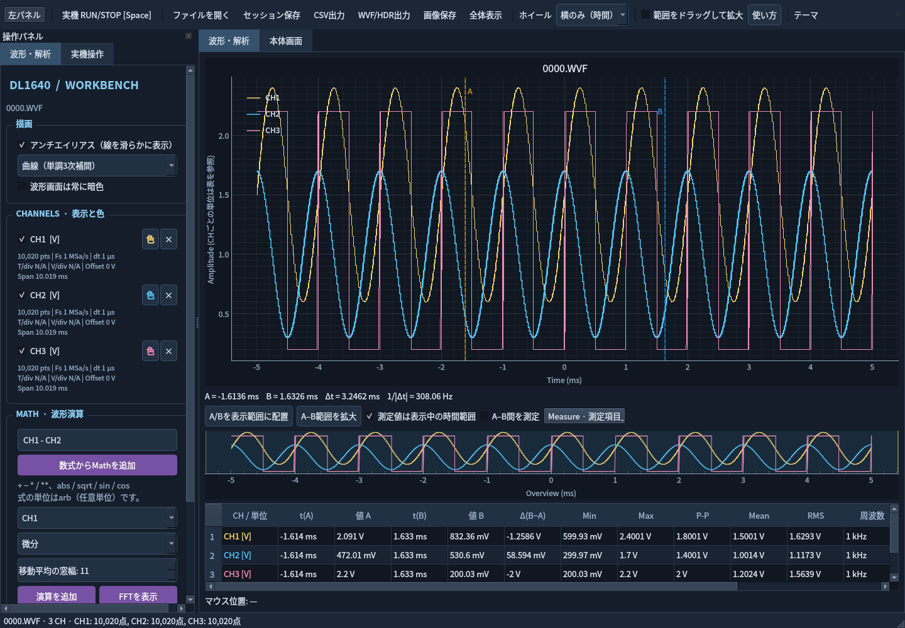

# DL1640 Waveform Workbench

YOKOGAWA DL1640の保存波形を表示・解析し、Ethernet経由で本体を操作するPythonデスクトップアプリです。Linuxを中心に、PySide6 / pyqtgraph / NumPyで実装しています。Windows用の起動スクリプトも用意していますが、Windows実機では未検証です。

仮完成版としてPython版に統一しました。Go/Rust版・Web版と、それら向けのAppImage/Flatpak配布処理は削除しています。



## 起動

Linuxの展開実行版は、tar.gzを展開して `./run.sh` で起動します。Pythonやuvの事前導入は不要です。対応CPU・glibc、配布先での起動、再ビルドの手順は[Linuxパッケージの作成と配布](docs/packaging-linux.md)を参照してください。

以下はソースから起動する場合の手順です。

[uv](https://docs.astral.sh/uv/getting-started/installation/)をインストールして、このフォルダで実行してください。初回はPythonと依存パッケージのダウンロードが必要です。

```bash
uv sync --locked --python 3.12
bash run.sh demo/0000.WVF
```

通常起動は `bash run.sh`、Windowsは `run.cmd` です。コマンドからは `uv run --locked --python 3.12 yokogawa-tool` で起動できます。別PCではプロジェクトと `uv.lock` をコピーして同期し、`.venv` はそのPCで作成してください。

## 主な機能

- WVF/HDR、CSV、`.scope.npz` / `.scope.json` の読み書き。セッションは元ファイルなしで再表示できます。
- `Ctrl+Shift+E`でPC解析用WVF/HDRを出力（FS8、整数への再量子化なし）。CSVは他ソフトとの交換、NPZは表示設定を含む保存に使えます。本体への再読込は未検証です。
- 時間軸または振幅軸のホイール拡大、Overview、A/Bカーソル、各CHの色・表示切替、統計値。
- 数式、微分、積分、移動平均、FFT。
- Measureの21項目を選択表示。周波数・周期・デューティ比・パルス幅・立上り／立下り時間などを、表示範囲・全体・A–B間で測定できます。
- 制御中の本体LCD消灯と接続前の状態への復元（選択可能、F1.08で確認）。
- 折り畳める左パネル、Dark / Light / Windows XP風Lunaのテーマ。
- DL1640の設定取得・自動反映、±ボタンによる調整、RUN/STOP、単発、波形取得。接続後は **Space** で実機の測定を開始・停止でき、読み出し中も操作を受け付けます。
- 数値波形はプレビュー優先で間欠取得し、切断時に最後の記録を全点取得します。更新周期は次回起動時も保持します。
- 表示用の単調3次補間、CHごとのサンプル時間・取得設定表示、波形背景を常に暗色にする設定に対応。
- 取得済み波形のUART・SPI・I²C・CAN解析（別途sigrok-cliが必要）。[EnDat 2.1/2.2の実験的な内蔵解析](docs/endat.md)にも対応。
- 独立した「本体画面」モードはHTTPで画面画像を取得し、RUN/STOPを操作しません。F1.08でRUN維持を確認していますが、1枚約7.3秒かかります。波形解析と画像表示は切り替えて使います。

## ドキュメント

[docsの一覧](docs/README.md)から参照できます。

| ドキュメント | 内容 |
|---|---|
| [使い方](docs/usage.md) | 起動、表示・解析、保存、実機操作、ライブ更新、トラブル対処 |
| [Linuxパッケージの作成と配布](docs/packaging-linux.md) | Python同梱の展開実行版、ビルド環境、配布・検証、wheelとソース配布 |
| [内部処理・実装](docs/implementation.md) | モジュール構成、ファイル形式、Math、描画、通信と非同期処理 |
| [開発・スクリプト](docs/development.md) | 起動スクリプト、描画計測、テスト、ビルド、配布、検証範囲 |

実機接続の初期値は `10.0.10.14:10001`、ユーザー `anonymous`、パスワード空欄です。使用する本体の設定に合わせて変更してください。

## ライセンスと公開範囲

独自コード・文書・合成デモは [MIT License](LICENSE) です。第三者ライブラリへMITを適用するものではありません。[第三者表記](THIRD_PARTY_NOTICES.md)を参照してください。

`demo/` は数式から生成した公開用データです。`samples/`・`captures/` の実測データは公開・配布しません。画面例も合成データに置き換えています。このソフトはYOKOGAWAの公式製品ではありません。

Python同梱バイナリはOS由来ライブラリの再配布条件も確認する必要があります。現時点の凍結実行版は検証用であり、GitHub Releasesへの公開確認が完了したものではありません。
